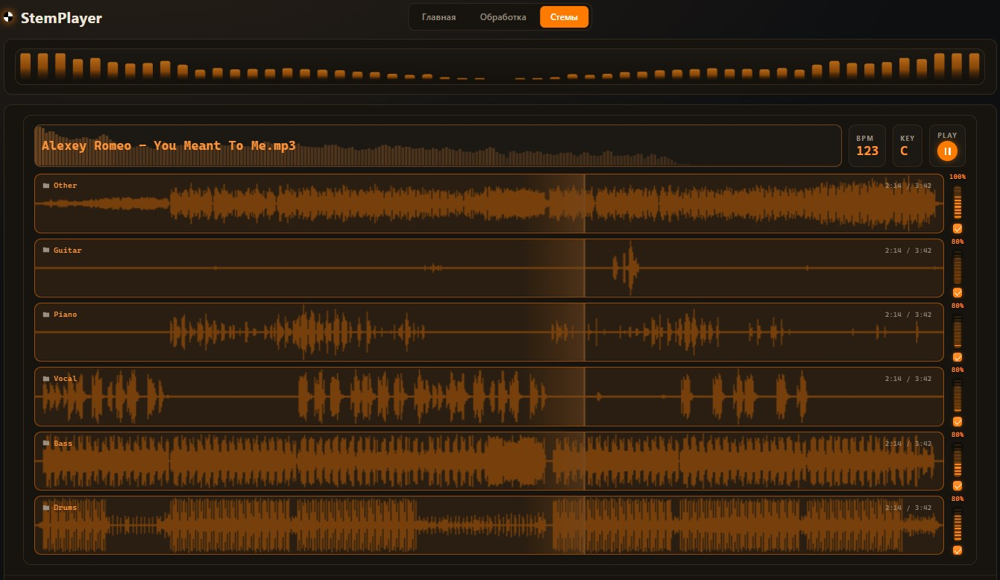

# StemPlayer

Веб-инструмент для работы с музыкальной библиотекой: сортировка треков по **BPM** и **тональности** и разделение каждого трека на **стемы** (вокал / бас / ударные / остальное) нейросетью [Demucs](https://github.com/facebookresearch/demucs) на CUDA-видеокарте, а стема **Other** — ещё и на **гитару** и **пиано**.

Бэкенд — PHP (XAMPP), вся обработка выполняется отдельными Python-процессами. **Версия 2.0.**

## Скриншот



## Возможности

Архитектура состоит из двух взаимосвязанных модулей с единым состоянием и взаимной блокировкой ресурсов:

**«Обработка» (`analysis/`)**
- Загрузка аудиофайлов drag-and-drop (mp3, wav, flac, ogg, aac, m4a, wma, aiff, aif до 300 МБ).
- Анализ темпа (BPM с адаптивной фильтрацией интро), гармонической тональности (Key), длительности и тегов.
- Автоматическая раскладка по каталогам `music/sorted/BPM{число}_Key{тональность}/`.
- Фоновый CLI-демон: вкладку браузера можно безопасно закрывать во время обработки.
- Встроенный аудиоплеер в строках таблицы, сортировка по колонкам, очередь «Подряд», безопасное удаление треков с очисткой всех связанных файлов.

**«Стемы» (`stemgen/`)**
- Нейросетевое разделение на 4 базовых стема (`vocals`, `drums`, `bass`, `other`) моделью Demucs `htdemucs_ft` в MP3 320 kbps.
- Каскадное извлечение инструментов: разделение стема **Other** на **Guitar** и **Piano** моделью `htdemucs_6s` с TTA-усреднением (`--shifts 3`) и сегментным перекрытием (`--overlap 0.5`).
- Последовательная фоновая очередь обработки треков без перегрузки VRAM.
- Интерактивный микшер стемов: регуляторы громкости и mute, единая перемотка, аппаратные волновые формы (waveform) с быстрым кэшированием в LocalStorage.
- Адаптивный стерео-эквалайзер (Stereo EQ) с процедурной фоновой анимацией и живым спектроанализатором при воспроизведении.
- Локальное сохранение любого отдельного стема на диск через File System Access API.

Модули работают согласованно: при активной обработке в одном модуле соседний автоматически блокируется на уровне API и защищается HTTP-редиректом (302) через `PageGuard`.

## Требования

| Компонент | Версия | Зачем |
| --- | --- | --- |
| XAMPP (Apache + PHP) | PHP 8.1+ | всё приложение |
| Python | 3.9+ (в PATH) | анализ (BPM/Key) и стемы |
| ffmpeg | любая | Demucs: декод mp3 и кодирование стемов |
| NVIDIA GPU + драйвер | от GTX 1060 6 ГБ | модуль «Стемы» на CUDA (обязательно) |
| Интернет | — | зависимости (~5 ГБ) и модель при установке |

## Быстрая установка (Windows)

Скопируйте или клонируйте проект в `C:\xampp\htdocs\StemPlayer` и запустите установщик **один раз**:

```powershell
powershell -ExecutionPolicy Bypass -File setup.ps1
```

Или просто **двойной клик по `setup.cmd`** (обходит политику выполнения).

Скрипт:

1. Проверяет Python 3.9+, ffmpeg и NVIDIA GPU (`nvidia-smi`, VRAM ≥ 6 ГБ).
2. Создаёт `venv_demucs/` и ставит туда `torch+torchvision` (CUDA 12.1) и `demucs`.
3. Ставит зависимости анализатора (`numpy`, `librosa`, `mutagen`).
4. Скачивает веса моделей Demucs (`htdemucs_ft`, `htdemucs_6s`).
5. Создаёт рабочие каталоги `music/`, `storage/`, `logs/`.

Если Python не в PATH — укажите путь: `setup.ps1 -Python C:\Python312\python.exe`. Повторный запуск безопасен: существующее окружение не пересоздаётся.

## Ручная установка

Если предпочитаете вручную:

1. Скопировать проект в `C:\xampp\htdocs\StemPlayer`.
2. Зависимости анализатора: `pip install -r requirements-analysis.txt`.
3. Окружение для стемов:

```
python -m venv venv_demucs
venv_demucs\Scripts\python.exe -m pip install torch torchvision --index-url https://download.pytorch.org/whl/cu121
venv_demucs\Scripts\python.exe -m pip install -r requirements-demucs.txt
```

4. `ffmpeg` — в PATH или в `C:\ffmpeg\bin` (скрипт найдёт его сам в типовых местах).

## Запуск

1. Запустите **Apache** в панели XAMPP.
2. Откройте `http://127.0.0.1/StemPlayer/`.
3. Первый запуск: перетащите треки в дропзону → «Обработать».

Каталоги `music/inbox/` и `music/sorted/` создаются автоматически.

## Настройка

Все параметры — в `config.php` (пути к Python/PHP, модель Demucs, битрейт, удаление исходника и т. д.). 

## Структура проекта

```
index.php       — стартовый хаб со ссылками на модули
config.php      — автозагрузка классов, пути к Python/PHP, параметры Demucs
core/           — ядро: атомарный ProgressStore, RunState, PageGuard, SpawnCli, PythonRunner
analysis/       — модуль анализа BPM/тональности, загрузка и сортировка
stemgen/        — модуль разделения на стемы, каскадный сплиттер и плеер
music/          — аудиофайлы: inbox/ (входящие) и sorted/ (сортированная библиотека со стемами)
storage/        — JSON-состояние демонов и кэш (progress.json, tracks.json, stemgen_progress.json)
logs/           — логи фоновых CLI-процессов
```

Подробное техническое описание архитектуры, контрактов API и межпроцессного взаимодействия см. в [TECH.md](TECH.md).

## Телефон и планшет

Обе страницы работают от 320 px до 1920 px без горизонтальной прокрутки. На узком экране таблица «Обработки» превращается в карточки, а каналы стемов идут в одну колонку.

## Лицензия

MIT © Sergey Nemo. Полный текст — в [LICENSE](LICENSE).

